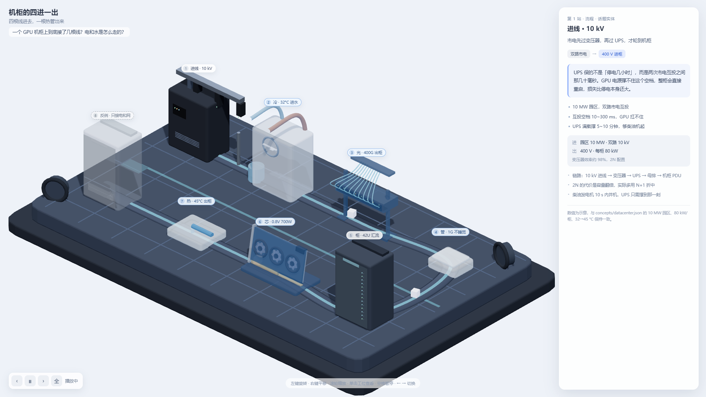

# concept-pipeline · 概念产线

把一个概念、一套机制，或一份几十页的文档，编译成**一条能走进去看的 3D 产线**——产出一个约 0.6 MB 的单文件 HTML，双击即开，可以直接发给别人。



上图是 `examples/rack-io.json`（机柜的四进一出）的产物截图：8 个工位沿 U 形动线排开，点任一站，右侧给这一站的输入、输出、量级和工程视角。

---

## 它到底在做什么

大多数「把知识做成图」的工具，产出的是**步骤列表**：第一步、第二步、第三步。读完了你还是不知道为什么必须这样。

这个概念产线加了两个硬约束，专门治这个毛病：

1. **每一对相邻实体之间，必须有一个「原理实体」**——用户没提到、也看不见的那个中介。判据只有一条：删掉它，因果链是否断裂。断裂才配占一个工位。
2. **必须有一个反例站**——换掉某个条件，结论就反转。想不出反例，通常说明这道题还没吃透。

所以它不写 3D 代码，也不做美术。模型只产出一份 JSON，渲染器只认这份 JSON。

## 快速开始

需要 Node 18+。脚本零依赖，只用 Node 内置模块。

```bash
# 1. 校验一份 concept：字段合法性 + 原理完备性（退出码 0 才算可用）
node scripts/validate.mjs examples/rack-io.json

# 2. 打包：JSON → 单文件 HTML
node scripts/build.mjs examples/rack-io.json out/rack-io.html
```

`build.mjs` 把渲染器、样式、内容全部内联进一个 HTML。没有外链、没有相对路径依赖、不需要起服务。

```bash
# 3. 实体查词：把中文词映射到渲染器认识的零件
node scripts/resolve.mjs 咖啡 咖啡豆 大脑
node scripts/resolve.mjs --json 咖啡因分子 腺苷受体 血脑屏障
```

输出会标 `词表` / `模糊` / `兜底`。**兜底意味着词表里没有这个词**，要看它给的 `note` 推荐的形状对不对。

## 示例

| 文件 | 主题 | 站数 | 配比（step / why / contrast） |
| --- | --- | --- | --- |
| `examples/ai-stack.json` | 大模型 · 从数据到服务（149 条考点的重排） | 8 | 4 / 3 / 1 |
| `examples/rack-io.json` | 机柜的四进一出（电、水、光、带外 → 热） | 8 | 4 / 3 / 1 |
| `examples/datacenter.json` | GPU 机房怎么搭（旧格式，**无 role / type**） | 6 | — |

第三份是旧格式（只有 `part`，没有 `entity` / `role` / `type`）：能渲染，但没有原理层，`validate` 会给一条提示。保留它只为对照——它演示了「有流程、没机制」长什么样。

## 方法：七个步骤

以下路径都相对仓库根目录。

1. **抽话题实体**——把话题里用户能看见的东西列全，查词表确认在不在。
2. **补原理实体**（全流程的分水岭）——相邻两站之间，用户会不会问「凭什么」？会问，就缺一个中介。硬约束：全篇 `principle` ≤ 5 个，每站最多新引入 1 个，且它必须成为下一站的输入。
3. **定反例**——至少一个 `type: "contrast"`。反例比前面所有站加起来更能说明「为什么必须是这样」。
4. **解析零件**——`resolve.mjs` 给出的 `part` / `custom` 直接贴进 station。看不见的东西不要给实体外形：分子用 `cluster`，场用 `field`，量级差用 `bars`，界面用 `membrane`。
5. **写 concept JSON**——字段见 `references/dsl.md`，题材骨架见 `references/chains.json`（命中就直接改写，不命中就现场推）。
6. **校验**——`validate.mjs` 退出码 0 才算可用。`[完备性]` 开头的三条是这套方法的核心，不能忽略。
7. **打包**——`build.mjs` 出单文件 HTML。

### 交付前的三问

1. 能不能一句话回答「为什么不是别的样子」？
2. 中间有没有一步是「然后奇迹发生」？有，就缺一个原理实体。
3. 有没有一个数字让人产生量级直觉？

### 红线

- 未查证的精确数值，只写进 `example.meta` 并标「示意」，不许写进 `bullets` 冒充事实。
- 同一个 `entity` 在多站出现时，`part` 和 `custom` 必须一致，否则观众会以为换了东西。
- 超过 8 个工位要拆：取主干 6 站，其余写进 `note`，不硬塞。
- 话题跨三个数量级时，选一个主尺度画，其余用数字交代。

## DSL 摘要

```jsonc
{
  "id": "rack-io",                  // 英文小写短横线
  "title": "机柜的四进一出",          // ≤ 12 字，要带具体限定词
  "subtitle": "四根线进去，一根热管出来",  // ≤ 20 字，从什么到什么
  "question": "一个 GPU 机柜上到底接了几根线？",
  "answer": "四根线进柜，一根热管出柜。",   // ≤ 20 字，可以反直觉
  "stage": "datacenter",            // desk / datacenter / nature / body
  "note": "数值为示意。",
  "stations": [ /* 3~8 个 */ ],
  "order": ["feed", "cold", "fiber", "oob", "rack", "chip", "heat", "dry"]
}
```

单个 station 的必填项：

| 字段 | 说明 |
| --- | --- |
| `entity` | 实体 id；同一实体跨站必须用同一个 `part` |
| `role` | `topic` 话题实体 / `principle` 原理实体 / `contrast` 反例 |
| `type` | `step` 接下来发生什么 / `why` 为什么必须这样 / `contrast` 不这样会怎样 |
| `part` | 零件 id，或 `custom` + 配方（`form` / `detail` / `size` / `color` / `accent`） |
| `name` | ≤ 12 字，带限定词（「供电 · 10 MW」而不是「供电」） |
| `inputLabel` / `outputLabel` | ≤ 8 字 |
| `short` | ≤ 30 字，这一站在做什么 |
| `insight` | 30~90 字，讲机制，**必须有反直觉点** |
| `bullets` | 3 条，每条 ≤ 30 字，只放事实或数量级 |
| `example` | `{ in, out, meta }` 具体值，禁止「若干」「大量」 |
| `tech` | 2~3 条工程视角：跑在什么硬件、什么算法、什么量级 |

`type` 的写法差别决定了内容质量：

- `step` 描述动作与结果，`insight` 给一个反直觉的补充；
- `why` 的 `insight` 必须讲机制（因为有 X，所以不可能 Y）；
- `contrast` 假设一个反事实，用同一个实体换条件。

## 目录

```
SKILL.md                 给 agent 读的说明书（工作流、判据、红线）
scripts/resolve.mjs      实体 → 零件，三级命中（词表 / 模糊 / 兜底）
scripts/validate.mjs     字段校验 + 原理完备性检查
scripts/build.mjs        concept.json → 单文件 HTML
references/dsl.md        字段定义与文案标准
references/mapping.md    角色判定、kind 矩阵、不可见实体怎么画
references/entities.json    话题实体词表（47 个，带形状预设）
references/principles.json  原理实体词表
references/chains.json      题材因果骨架
references/stages.json      场域预设
assets/renderer.js       预打包渲染器（three.js + 场景，内联进产物）
assets/template.html     页面骨架
assets/styles.css        样式
examples/                三份可直接跑的 concept
docs/preview.png         产物截图
```

## 安装成 WorkBuddy skill

`SKILL.md` 带 YAML front matter（`name` / `description`），是这个 agent 的 skill 格式。放到下面任一位置即可被识别：

```bash
# 用户级：所有项目可用
git clone git@github.com:skywei1996/concept-pipeline.git ~/.workbuddy/skills/concept-pipeline

# 项目级：只在某个工作区可用
git clone git@github.com:skywei1996/concept-pipeline.git <workspace>/.workbuddy/skills/concept-pipeline
```

触发词：讲明白、拆解、可视化某个概念、把这份材料变成能看懂的流程。

## 已知限制

- **最多 8 站。**超过就该拆成两条产线，而不是压缩。
- **只适合「一站一因果」的链式结构。**多对多的系统（比如整个 GPU 机房的 21 个物件、5 条流同时在场）不适合硬塞进产线，那张图是另外做的 SVG 拓扑图。用错形态是最常见的失败模式。
- **数值只作量级示意**，不是特定系统的实测数据。涉及具体型号的参数要自己核。
- 产物约 0.6 MB，因为 three.js 内联在里面——换来的是「双击就能开、发微信也不会挂」。

## License

本仓库暂未声明 License。如需转载或商用，先联系作者。
